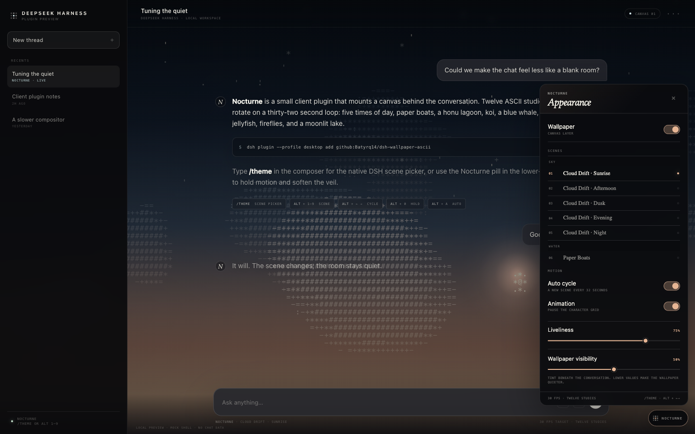
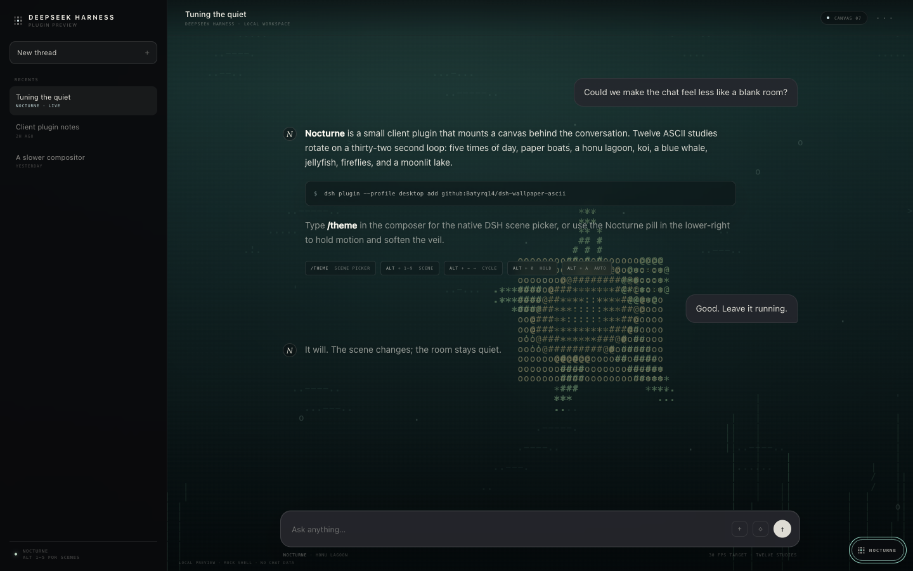
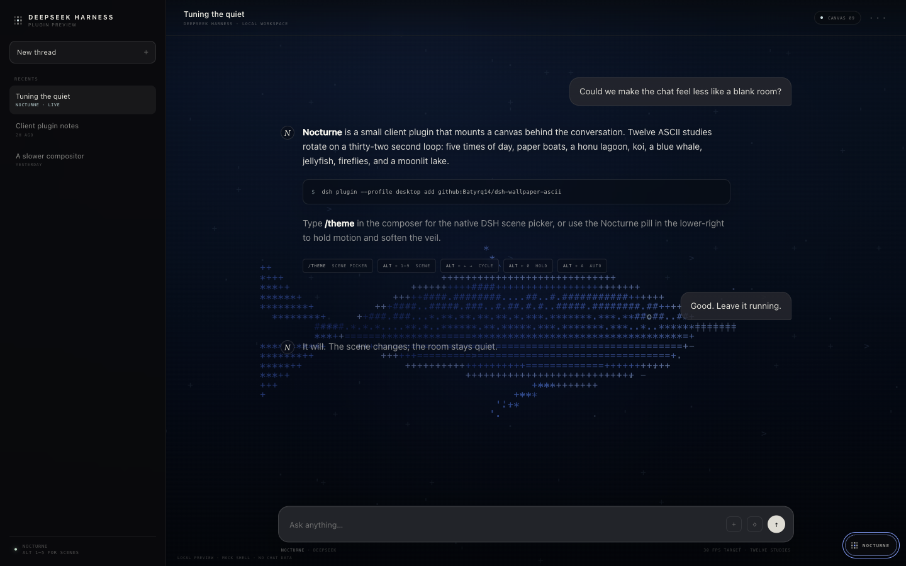
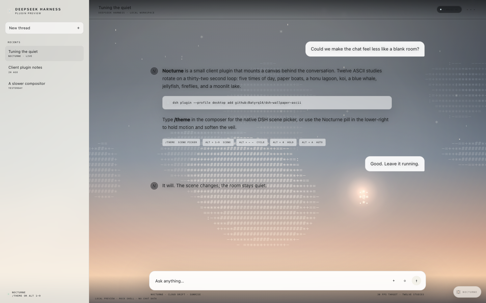

# Nocturne Wallpaper

A small, self-contained **DeepSeek Harness web-client plugin** that paints a living ASCII wallpaper behind the chat, with a native `/theme` command, a light-theme treatment, and a compact appearance panel for changing it without touching code.

Twelve scenes rotate on a slow loop:

- **Cloud Drift** in five lights: **Sunrise**, **Afternoon**, **Dusk**, **Evening**, and **Night**
- **Paper Boats**
- **Honu Lagoon**
- **Koi Pond**
- **DeepSeek** — a blue whale in the deep
- **Jellyfish**
- **Fireflies**
- **Moonlit**

Everything is drawn on a single full-screen canvas at a capped 30 fps. Type **`/theme`** in the DSH composer for the native scene picker, or open the **Nocturne** pill in the lower-right corner. At runtime the plugin uses no images, videos, web fonts, or network requests, and the package needs no build step.


<details>
<summary>Appearance panel</summary>



</details>

<details>
<summary>Honu Lagoon</summary>



</details>

<details>
<summary>DeepSeek, the blue whale</summary>



</details>

<details>
<summary>Light theme</summary>



</details>

> Unofficial community plugin. Not affiliated with DeepSeek.

## What it does

- Mounts a fixed character-grid canvas behind the DSH web UI.
- Registers a client-owned **`/theme`** command in DSH's slash-command menu. It opens the native searchable scene picker, grouped by **Sky**, **Water**, **Deep**, and **Night**, with the current scene highlighted. Selecting a row changes the wallpaper without creating a model message.
- Opens a compact shadow-DOM appearance panel from the Nocturne pill in the corner.
- Lets you pick any of the twelve scenes, toggle auto-cycle and animation, adjust **Liveliness**, and adjust wallpaper visibility.
- Turns the canvas layer off without uninstalling the plugin.
- Makes the application base layer translucent so the wallpaper shows through the conversation.
- Grades the canvas and uses a warm, centre-weighted paper wash in the light theme: the art stays visible, and conversation text stays legible.
- Keeps message bubbles and the composer slightly translucent to match.
- Adds a subtle pointer parallax and a slow idle drift; the wallpaper leans with the cursor instead of sitting perfectly still.
- Rotates scenes every 32 seconds.
- Switches scenes with a 1.35 second **staggered ASCII dissolve**: the old scene is held in vertical strips that clear in a soft wave, while a thin accent seam travels across the grid.
- Pauses automatically when the tab is hidden.
- Respects `prefers-reduced-motion`: motion slows down and auto-rotation starts off.
- Remembers scene, motion, liveliness, enabled state, and visibility in `localStorage`.
- Removes every node, stylesheet, listener, and inline attribute when the plugin unloads.

No chat content is read and no network calls are made. Only wallpaper preferences are stored locally. `/theme` is handled entirely in the browser by DSH's client command shell; it never reaches the model.

## Install

The plugin is plain JavaScript and ships prebuilt. It has no dependencies and needs no `prepare` build.

### From GitHub

```sh
dsh plugin --profile desktop add github:Batyrq14/dsh-wallpaper-ascii
```

### From a local checkout

```sh
dsh plugin --profile desktop add file:/absolute/path/to/dsh-nocturne-wallpaper
```

Use `web` instead of `desktop` if that is the profile you run. Restart the web app after installing. The plugin shows up in **Settings → Plugins** as `dsh-nocturne-wallpaper`.

If you forked the repository under another account, replace `Batyrq14/dsh-wallpaper-ascii` in the command above.

### Remove

```sh
dsh plugin --profile desktop remove dsh-nocturne-wallpaper
```

Restart to return to the stock background.

## Controls

### `/theme`

Type `/theme` in the composer and press Enter. DSH opens its native command picker with every Nocturne scene. Type to filter, use the arrow keys to move, and press Enter or Tab to select. The current scene is marked and starts highlighted. The command appears under **Commands** in the `/` menu as **Theme** with the description *Choose a Nocturne wallpaper scene.*

The command is a client-owned contribution: it consumes no model turn, sends no message, and needs no host-side command handler.

### Panel

Click the **Nocturne** pill in the lower-right corner to open the appearance panel. It includes scene selection grouped by sky, water, deep, and night, plus auto-cycle, animation, **Liveliness**, wallpaper visibility, and an on/off switch for the canvas layer.

**Liveliness** runs from calm to animated. It changes the scene clock (the default is 75, about 23% faster than the original pace) and the strength of the pointer parallax. The setting is saved with the other preferences.

### Keyboard

Shortcuts are ignored while typing in an input, textarea, select, or contenteditable field.

| Shortcut | Action |
| --- | --- |
| `Alt/Option + 1–9` | Jump into the first nine scenes (five cloud studies, boats, honu, koi, whale) |
| `Alt/Option + → / ←` | Next / previous scene |
| `Alt/Option + 0` | Pause / resume the character animation |
| `Alt/Option + A` | Toggle automatic scene rotation |

### Console API

```js
nocturneWallpaper.scenes                // ["Cloud Drift · Sunrise", ...]
nocturneWallpaper.catalog()             // [{ id, title, tag, group, index, active }, ...]
nocturneWallpaper.status()              // { index, id, name, group, paused, auto, enabled, visibility, liveliness }
nocturneWallpaper.show("deepseek")      // id, title, or 0-based index
nocturneWallpaper.show("Moonlit")
nocturneWallpaper.next()
nocturneWallpaper.previous()
nocturneWallpaper.pause()
nocturneWallpaper.resume()
nocturneWallpaper.togglePause()
nocturneWallpaper.setAuto(false)        // pin the current scene
nocturneWallpaper.toggleAuto()
nocturneWallpaper.enable()              // show the canvas layer
nocturneWallpaper.disable()             // hide the canvas layer
nocturneWallpaper.toggleEnabled()
nocturneWallpaper.setVisibility(78)     // 0-100; higher makes the wallpaper stronger
nocturneWallpaper.setLiveliness(90)     // 0-100; animation speed and parallax strength
nocturneWallpaper.openPanel()
nocturneWallpaper.closePanel()
```

## How it works

```text
package.json        declares dsh.bundle + dsh.client (web)
cordis.patch.yml    inserts the plugin's Loader row
lib/index.js        empty host half; keeps the package in the roster
lib/client.js       browser half: canvas, scenes, controls, /theme command, cleanup
preview/            self-contained mock DSH shell for local preview
```

The host half only exists so that the package appears in the Loader and in **Settings → Plugins**. The browser half is discovered through the package's `dsh.client` manifest and served into the Web Client as a normal client module.

At mount time the browser half:

1. Appends `#nocturne-canvas` and `#nocturne-wash` to the body at negative z-index.
2. Sets `data-nocturne="on"` on the body and makes the UI base layer translucent.
3. Applies a theme-aware grade and tint so the wallpaper is atmospheric rather than distracting.
4. Mounts the shadow-DOM appearance panel and its trigger.
5. Starts a 30 fps character-grid renderer.
6. Smooths pointer position into a subtle parallax, scaled by **Liveliness** and disabled under reduced motion.
7. When DSH's `commandUi` service is present, registers the client-owned `/theme` command through `ctx.commandUi.register(...)`. The wallpaper still mounts normally in compositions without that service; only the slash command is skipped.

All of it is wrapped in `ctx.effect(...)`, so a hot reload or plugin removal restores the original UI.

### Scenes

Each scene owns its colour, accent, caption, group, and animation. The five cloud studies share a single `CloudDrift` renderer but receive different palettes, star fields, light positions, and cloud layers. The new studies:

- **Paper Boats** drifts folded paper boats and floating candles across a dark harbour.
- **Honu Lagoon** follows a green sea turtle over sunlit lagoon caustics, sea grass, and bubbles.
- **DeepSeek** is a blue whale rendered as a long tapered silhouette with a forked tail, pectoral fin, and a bright eye in the deep.

### Readability

The wallpaper sits beneath a theme-aware veil and a tinted app root. The dark theme uses a subtle dark tint. The light theme is handled differently: the root tint drops to a low alpha, the canvas gets a slight brightness and saturation grade, the HTML underlay changes from black to warm paper, and a centre-weighted cream wash keeps the chat column readable while leaving the edges of the scene visible. Bubble and composer surfaces stay high-opacity white. The **Wallpaper visibility** slider reduces both the root tint and the light wash, so higher values reveal more art.

If you want to tune the effect further, override `--nocturne-app-tint` after the plugin's stylesheet in your own theme CSS; `--nocturne-underlay` controls the colour behind the canvas.

## Performance

- One canvas, one animation loop, and a 30 fps draw budget.
- Only the active scene is drawn each frame; all twelve are cheap to initialise.
- Character grid rebuilt only on resize.
- Device pixel ratio capped at 1.6 and total canvas pixels capped at 8.5M.
- Rendering stops while the tab is hidden.
- The scene transition costs one snapshot plus 44 vertical strip blits for 1.35 seconds, then returns to the normal single-scene path.
- Particle tables are seeded and reused; no network or image decoding happens while running.
- Pointer parallax is a passive listener updating two numbers; the eased values are applied inside the existing draw call.
- The appearance panel is static DOM; no continuous CSS filter or backdrop-filter work is added by the plugin itself.

## Compatibility

Built for DeepSeek Harness **0.2.1-rc.3** on macOS. It relies on the documented `dsh.bundle` / `dsh.client` package manifests and on the `data-ds-dark-theme` body attribute used by the shipped theme presenter. The `/theme` command uses the documented `ctx.commandUi` client command surface; the panel and wallpaper work without it. The included preview harness exercises the real browser bundle against a mock DSH shell; after installing, check the result in your own profile.

## Local preview

The preview is a mock DSH shell, not a second application. It loads the real `lib/client.js` through a minimal module-loader shim so you can inspect the wallpaper without installing the plugin. It also mocks the client command service so the `/theme` registration can be exercised; the native command popup is only rendered by DSH itself.

```sh
cd dsh-nocturne-wallpaper
python3 -m http.server 8080
# http://localhost:8080/preview/
```

Or open `preview/index.html` directly in a modern browser.

## Development check

```sh
npm run check
npm pack --dry-run
```

## License

MIT. See [LICENSE](LICENSE).
