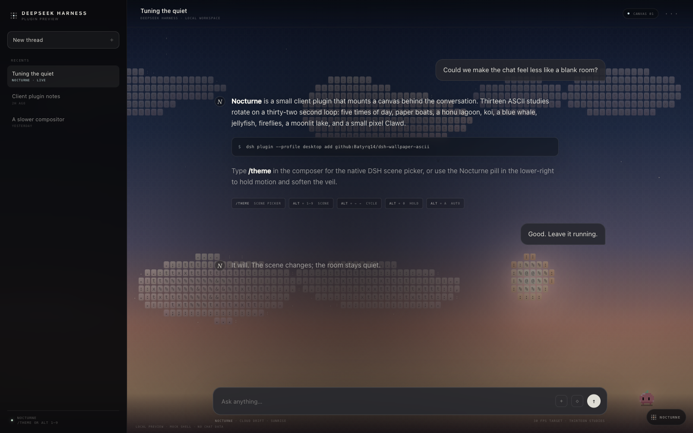
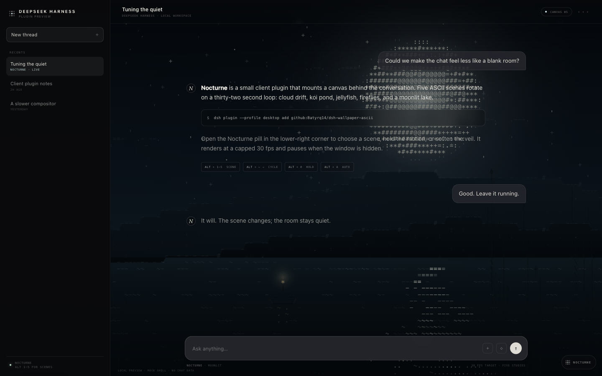

# Nocturne Wallpaper

A small, self-contained **DeepSeek Harness web-client plugin** that paints a living ASCII wallpaper behind the chat.

Five scenes rotate on a slow loop: **Cloud Drift**, **Koi Pond**, **Jellyfish**, **Fireflies**, and **Moonlit**. Everything is drawn on a single full-screen canvas at a capped 30 fps. At runtime it uses no images, videos, web fonts, or network requests, and the package needs no build step.



<details>
<summary>Another scene: Moonlit</summary>



</details>

> Unofficial community plugin. Not affiliated with DeepSeek.

## What it does

- Mounts a fixed character-grid canvas behind the DSH web UI.
- Makes the application base layer translucent so the wallpaper shows through the conversation.
- Adds a theme-aware tint, and a light wash in the light theme, so chat text stays readable.
- Keeps message bubbles and the composer slightly translucent to match.
- Rotates scenes every 32 seconds with a 1.35 second crossfade.
- Pauses automatically when the tab is hidden.
- Respects `prefers-reduced-motion`: motion slows down and auto-rotation starts off.
- Removes every node, stylesheet, listener, and inline attribute when the plugin unloads.

No chat content is read. No settings are stored. No network calls are made.

## Install

The plugin is plain JavaScript and ships prebuilt. It has no dependencies and needs no `prepare` build.

### From GitHub

```sh
dsh plugin --profile desktop add github:Batyrq14/dsh-wallpaper-ascii
```

### From a local checkout

```sh
dsh plugin --profile desktop add file:/absolute/path/to/dsh-nocturne-wallpaper
```

Use `web` instead of `desktop` if that is the profile you run. Restart the web app after installing. The plugin shows up in **Settings → Plugins** as `dsh-nocturne-wallpaper`.

If you forked the repository under another account, replace `Batyrq14/dsh-wallpaper-ascii` in the command above.

### Remove

```sh
dsh plugin --profile desktop remove dsh-nocturne-wallpaper
```

Restart to return to the stock background.

## Controls

The wallpaper is intentionally chrome-free. Scene changes use keyboard shortcuts, and are ignored while typing in an input, textarea, select, or contenteditable field.

| Shortcut | Action |
| --- | --- |
| `Alt/Option + 1–5` | Jump to Cloud Drift, Koi Pond, Jellyfish, Fireflies, or Moonlit |
| `Alt/Option + → / ←` | Next / previous scene |
| `Alt/Option + 0` | Pause / resume the character animation |
| `Alt/Option + A` | Toggle automatic scene rotation |

The same controls are available from the console through `window.nocturneWallpaper`:

```js
nocturneWallpaper.scenes                // ["Cloud Drift", "Koi Pond", ...]
nocturneWallpaper.status()              // { index, name, paused, auto }
nocturneWallpaper.show("Moonlit")       // also accepts a 0-based index
nocturneWallpaper.next()
nocturneWallpaper.previous()
nocturneWallpaper.pause()
nocturneWallpaper.resume()
nocturneWallpaper.togglePause()
nocturneWallpaper.setAuto(false)        // pin the current scene
nocturneWallpaper.toggleAuto()
```

## How it works

```text
package.json        declares dsh.bundle + dsh.client (web)
cordis.patch.yml    inserts the plugin's Loader row
lib/index.js        empty host half; keeps the package in the roster
lib/client.js       browser half: canvas, scenes, controls, cleanup
preview/            self-contained mock DSH shell for local preview
```

The host half only exists so that the package appears in the Loader and in **Settings → Plugins**. The browser half is discovered through the package's `dsh.client` manifest and served into the Web Client as a normal client module.

At mount time the browser half:

1. Appends `#nocturne-canvas` and `#nocturne-wash` to the body at negative z-index.
2. Sets `data-nocturne="on"` on the body and makes the UI base layer translucent.
3. Tints the application root so the wallpaper is atmospheric rather than distracting.
4. Starts a 30 fps character-grid renderer.

All of it is wrapped in `ctx.effect(...)`, so a hot reload or plugin removal restores the original UI.

### Readability

The wallpaper sits beneath a theme-aware veil and a tinted app root. The dark theme uses a subtle dark tint; the light theme uses a warm paper wash so dark text remains legible. Bubble and composer surfaces are kept at high opacity. If you want to tune the effect, override `--nocturne-app-tint` after the plugin's stylesheet in your own theme CSS.

## Performance

- One canvas, one animation loop, and a 30 fps draw budget.
- Character grid rebuilt only on resize.
- Device pixel ratio capped at 1.6 and total canvas pixels capped at 8.5M.
- Rendering stops while the tab is hidden.
- Particle tables are seeded and reused; no network or image decoding happens while running.
- No continuous CSS filter or backdrop-filter work is added by the plugin itself.

## Compatibility

Built for DeepSeek Harness **0.2.1-rc.3** on macOS. It relies on the documented `dsh.bundle` / `dsh.client` package manifests and on the `data-ds-dark-theme` body attribute used by the shipped theme presenter. The included preview harness exercises the real browser bundle against a mock DSH shell; after installing, check the result in your own profile.

## Local preview

The preview is a mock DSH shell, not a second application. It loads the real `lib/client.js` through a minimal module-loader shim so you can inspect the wallpaper without installing the plugin.

```sh
cd dsh-nocturne-wallpaper
python3 -m http.server 8080
# http://localhost:8080/preview/
```

Or open `preview/index.html` directly in a modern browser.

## Development check

```sh
npm run check
npm pack --dry-run
```

## License

MIT. See [LICENSE](LICENSE).